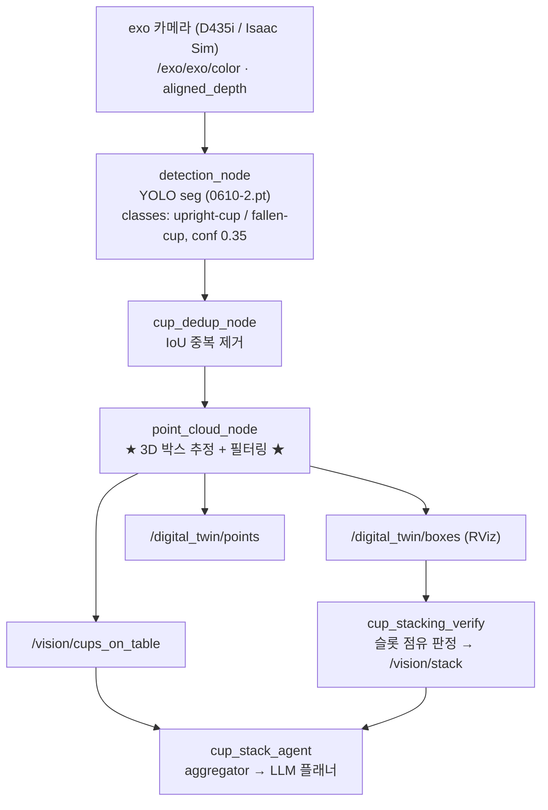
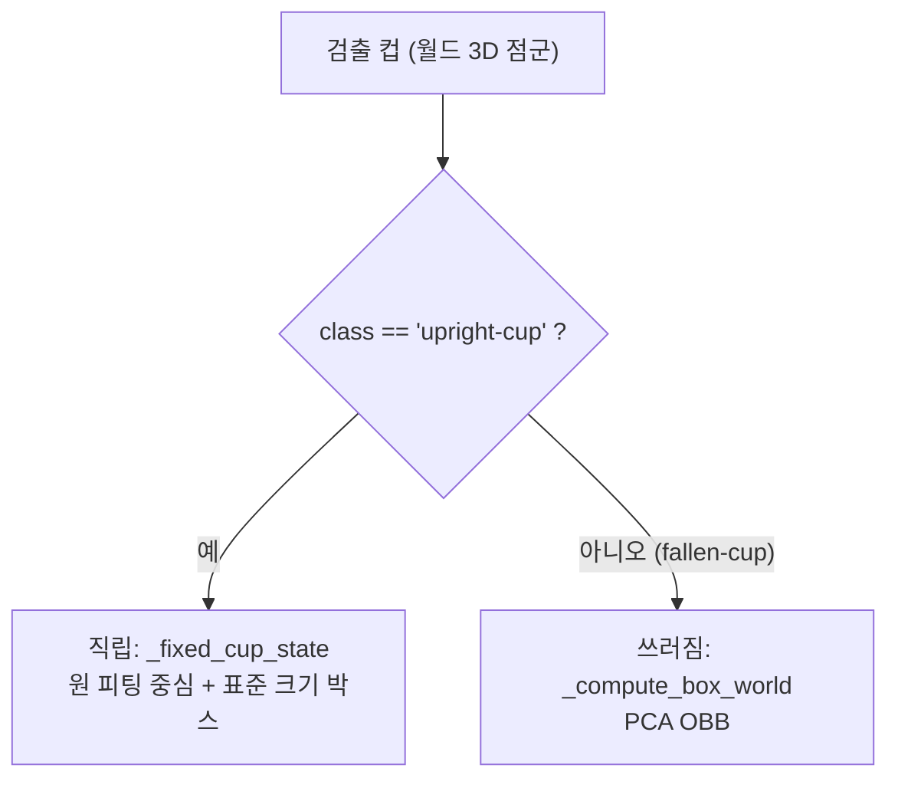

# Cup Detection & 3D Box Framework (exo 카메라) — 소개/발표 가이드

> exo 카메라 기반 컵 인지 파이프라인이 **검출(YOLO) → 점군화 → 3D 박스 추정 → 노이즈 필터링**까지
> 어떻게 동작하는지, **직립 컵(upright)** 과 **쓰러진 컵(fallen)** 을 각각 어떻게 처리하는지, 그리고
> **발표 때 어떻게 설명하면 되는지**를 정리한 문서.
>
> ※ 모든 수치는 실행 중인 노드가 로드한 파라미터(`_params_sim_origin.gen.yaml`)를 직접 확인해 확정한 값.

---

## 0. 한 문장 요약 (발표 오프닝용)

> **YOLO로 컵을 검출하고, point_cloud_node가 마스크를 3D 점군으로 만든 뒤 — 직립 컵은
> 점군을 위에서 내려다본 평면에 원(circle) 피팅으로 중심을 잡아 표준 크기 박스를, 쓰러진 컵은
> 점군 PCA로 OBB를 씌워 자세를 추정한다. 모든 추정은 다중 프레임 누적 + 노이즈 필터 +
> 칼만 필터로 시간 평활된다.**

---

## 1. 전체 파이프라인



| 단계 | 노드 | 입력 | 출력 | 역할 |
|---|---|---|---|---|
| ① 카메라 | `exo` | — | `/exo/exo/color`, `/exo/exo/aligned_depth_to_color` | RGB + 정렬 depth |
| ② 검출 | `detection_node` | RGB | `/digital_twin/detections_raw` | YOLO 세그멘테이션(마스크+클래스+track id) |
| ③ 중복제거 | `cup_dedup_node` | detections_raw | `/digital_twin/detections` | 같은 컵 중복 박스 IoU 병합 |
| ④ **3D 박스** | **`point_cloud_node`** | detections + RGB + depth | `/digital_twin/boxes`, `/vision/cups_on_table`, `/digital_twin/points` | **마스크 역투영 → 점군 → 박스 + 필터링** |
| ⑤ 소비 | `cup_stacking_verify`, `cup_stack_agent` | boxes, cups_on_table | `/vision/stack`, 플랜 | 슬롯 판정 / LLM 플래닝 |

**발표 포인트:** "인지는 4단계 — *검출 → 중복제거 → 3D 박스 → 후단 소비*. 핵심 로직은 ④ point_cloud_node에 있다."

---

## 2. 핵심 분기 — 직립 vs 쓰러짐

`point_cloud_node`는 검출된 각 컵의 **클래스 라벨**로 박스 추정 방식을 가른다.



| 항목 | 직립 컵 (`upright-cup`) | 쓰러진 컵 (`fallen-cup`) |
|---|---|---|
| 함수 | `_fixed_cup_state` → `_fixed_cup_centroid` | `_compute_box_world` |
| 중심 | **XY 투영 원(Kåsa) 피팅** | 점군 min/max 중점 |
| 자세 | 축 정렬 (yaw=0) | **XY PCA 주축 → yaw (OBB)** |
| 크기 | **알려진 표준 컵 치수 고정** | 점군 실측 extent |
| 공통 | 중심을 **칼만 필터**로 시간 평활 | 중심을 칼만 필터로 평활 (자세·크기는 매 윈도우) |

> "OBB를 친다"는 설명은 **쓰러진 컵에만** 정확. 직립 컵은 OBB가 아니라 *원 피팅 + 고정 박스*.

---

## 3. 직립 컵 상세 — Kåsa 대수 원 피팅

### 3.1 입력은 3D, 피팅은 XY 투영
- 입력 `all_pts`(N×3) = YOLO **마스크**로 고른 픽셀을 depth로 역투영해 만든 **월드 3D 점군**
- 원 피팅은 그 점의 **X, Y 열만** 사용 = **위에서 내려다본 평면 투영**. Z는 따로 바닥 높이로 사용.

### 3.2 무엇을 구하나 — 중심 (cx, cy) = 컵의 수직 축
- **반지름이 목적이 아님.** 컵은 절두원뿔이라, 보이는 앞벽 점들을 XY로 깔면 `r_bot`~`r_top` 폭의
  **부분 호(arc) 형태 고리**가 된다. 피팅 반지름은 그 사이 어딘가의 블렌드 값 → **"컵 크기 맞나"
  검증용**으로만 쓰고 버린다.
- **실제로 쓰는 값은 중심 (cx, cy)** 하나 = 컵이 서 있는 수직 축의 XY 위치.

### 3.3 왜 평균이 아니라 "원 피팅"인가 (이게 핵심 메시지)
- 카메라는 컵의 **앞쪽 반만** 본다.
- **그냥 평균/median** → 보이는 앞면 쪽으로 중심이 **쏠림**(편향). ❌
- **원(곡률) 피팅** → 보이는 호가 휘는 정도로 **안 보이는 뒤쪽 축까지 외삽**해 진짜 중심을 잡음. ✅
- 즉 *"앞면만 보여서 생기는 중심 편향을 곡률로 보정"* 하는 게 원 피팅을 쓰는 이유.

### 3.4 Kåsa = 한 번의 선형 풀이
원의 식 $(x-a)^2+(y-b)^2=r^2$ 를 전개하면 $x^2+y^2 = 2a\,x + 2b\,y + (r^2-a^2-b^2)$ →
미지수 $a,b,c$ 에 대해 **선형**. 반복 없이 `lstsq` 한 방.
```python
A = np.column_stack([2*x, 2*y, np.ones(n)])   # 3D 점의 X,Y만
sol = np.linalg.lstsq(A, x*x + y*y)            # → 중심 (cx, cy)
```

### 3.5 안전장치 (Kåsa의 부분-호 편향 보완)
아래를 **모두** 만족할 때만 원-피팅 중심 채택, 아니면 **median 폴백**:
- 반경 ∈ `[0.6, 1.6] × 컵 반경`
- 피팅 중심이 median에서 `≤ 컵 반경`
- 반경 잔차 MAD `≤ 0.30 × 컵 반경`
- **각도 커버리지 `≥ 120°`** (호가 너무 좁으면 곡률 외삽 불안정 → 거부)

### 3.6 바닥 높이(z)와 박스
- `z_base` = median z 주변 `±z_band/2`(0.12 m) 밴드 안 낮은 백분위(10%)
- 박스 크기 = `max(top_d, bot_d) × height` (표준 컵 치수, 고정)

> **이 모듈이 점군에서 실제로 뽑는 정보:** `cx, cy`(원 피팅 중심), `z_base`(percentile). 반지름·자세·
> 크기는 사전지식으로 고정. → "검출 점군에서 **위치만** 견고하게, 형상은 알고 있으니 고정."

---

## 4. 쓰러진 컵 상세 — PCA OBB (`_compute_box_world`)

크기 사전지식만으로는 누운 방향을 알 수 없으므로, 점군에 **방향성 박스(OBB)** 를 씌워 자세까지 추정.
```
1) z extent 지배적 (z_ext/h_ext > standing_ratio=0.8) → 사실상 서 있음 → 축 정렬
2) 그 외 → XY 평면 PCA
     elongation = sqrt(λ_major/λ_minor) ≥ min_elongation(1.5) 일 때만 yaw 회전 확정
     주축 방향 = arctan2(주고유벡터) → z축 회전 R → 로컬 min/max로 size·center
3) elongation 부족 → 방향 불확실 → 축 정렬('unknown')
```
> 누운 컵은 XY에서 명확히 길쭉 → PCA 주축이 **누운 축 방향**을 안정 복원. 회복(recovery) 동작의
> grasp 방향 prior로 사용. (직립=원 피팅, 쓰러짐=PCA, 둘 다 XY 투영 기반)

---

## 5. 노이즈 처리 — 프레임 누적 + 필터 + 칼만 (★ 발표 강조 ★)

매 프레임마다 핏하지 않는다. **2단계 주기 + 다겹 필터**.

### 5.1 2-tier 주기
| 단계 | 주기 (확정) | 하는 일 |
|---|---|---|
| **매 프레임** `_process_frame` | 카메라 속도 | 마스크 점 역투영 → 트랙 버퍼에 **누적만** (핏·발행 X) |
| **윈도우 종료** `_finalize_window` | **`window_period_s = 0.1 s` (~10 Hz)** | 누적 점 모아 → 필터 → 핏 → KF → 발행 |

→ 한 번의 핏이 0.1초간 **여러 프레임 점을 모아서** 쓰므로 핏 자체가 더 조밀·강건.

### 5.2 핏 전 공간 필터 (확정 활성)
| 필터 | 라이브 값 | 효과 |
|---|---|---|
| 다운샘플 `downsample` | 4 | 점 1/4 |
| 마스크 침식 `mask_erode_px` | 3 px | 경계 노이즈 제거 |
| **MAD 아웃라이어** `box_outlier_mad_k` | **3.0** | 축별 3σ 밖 점 제거 |
| **공간 밀도 필터** `use_spatial_density_filter` | **true** (r=30 mm, ≥5점) | 고립 노이즈 섬 제거 |
| ~~top-rim 밴드~~ `top_rim_band_m` | **0.000 = 꺼짐** | (발표에서 **언급 금지** — 비활성) |

### 5.3 칼만 필터 `PositionKF` — 시간 평활 (확정 활성)
발행되는 박스 중심은 **윈도우 raw 핏이 아니라 KF로 평활된 값**.

- **모델 = "컵은 가만히 있다"** (constant-position). 매 윈도우 `predict()`로 공분산이 Q만큼 자라 새
  측정을 천천히 따라감 → *약간 틀린 핏을 지속 교정*.
- **Mahalanobis 게이트** → 튀는 윈도우(depth 스파이크) **거부**, 추정값 유지.
- **잔차로 측정 신뢰 조절**: `infl = 1 + kf_resid_infl·(residual/cup_fit_residual_max)` → 퍼지거나
  편향된 핏은 덜 믿어 덜 끌려감 (직립 모드 잔차 = `max(8 mm, XY 퍼짐)`).
- **연속 거부 → 재획득**: 컵이 진짜 움직이면 추적 새로 잡음.

| KF 파라미터 | 라이브 값 | 의미 |
|---|---|---|
| `kf_process_std_xy_m` / `_z` | 0.002 / 0.004 | 윈도우당 허용 드리프트 Q |
| `kf_meas_std_xy_m` / `_z` | 0.005 / 0.010 | 1회 핏 가정 오차 R |
| `kf_gate_mahalanobis` | **9.0** | χ²(3)≈97%, 이 밖 스파이크 거부 (0=비활성) |
| `kf_resid_infl` | **1.0** | 잔차만큼 R 팽창 |
| `cup_fit_residual_max` | 0.02 | 잔차 팽창 기준 |
| `kf_reacquire_windows` | 3 | 연속 3윈도우 거부 → 재획득 |
| `kf_settled_std_m` | 0.006 | 1σ<6 mm → "정착(settled)" |
| `kf_init_std_m` | 0.05 | 초기/재획득 불확실도 |

**발표 포인트:** "한 프레임의 노이즈·스파이크가 박스를 흔들지 못한다 — *다중 프레임 누적 →
MAD·밀도 필터 → 정위치 칼만 필터(스파이크 게이팅)* 의 3중 보정 때문."

---

## 6. 다운스트림 소비
- **`/digital_twin/boxes`** → `cup_stacking_verify`가 가상 피라미드 슬롯과 대조해 점유 판정(`/vision/stack`)
- **`/vision/cups_on_table`** (JSON `{색상:개수}`) → `cup_stack_agent` aggregator → LLM 플래너.
  **쓰러진 컵은 집계 제외**(집을 수 없는 컵을 "가용"으로 세지 않도록).
- **`/digital_twin/points`** → RViz 시각화

> 참고: `rim_obs_enabled=true`라 실루엣 정합(`fit_silhouette_xy`) 채널도 돌지만, 다중카메라
> 융합(`cup_fusion_node`) 모드에서만 박스에 반영. 현재 단일 exo(standalone)에서는 디버그
> (`/digital_twin/rim_debug`)로만 발행 → **발표에서는 생략 권장**.

---

## 7. 적용 설정 (확정 값)

| 파라미터 | 값 | 출처 |
|---|---|---|
| YOLO model / classes / conf | `0610-2.pt` / `[upright-cup, fallen-cup]` / 0.35 | sim params |
| `cup_class_names` | `["upright-cup"]` | sim params |
| `fixed_cup_box` | `true` | 노드 기본값(미설정) |
| `box_force_aabb` / `box_standing_ratio` / `box_min_elongation` | false / 0.8 / 1.5 | sim params |
| `window_period_s` | **0.1** | sim params |
| `box_outlier_mad_k` | 3.0 | sim params |
| `use_spatial_density_filter` (r / N) | true (0.03 / 5) | sim params |
| `top_rim_band_m` | **0.000 (off)** | sim params |
| KF (Q/R/gate/resid_infl/reacq/settled) | 위 5.3 표 | sim params |
| `fixed_cup_base_pct` / `fixed_cup_z_band_m` / `fixed_cup_kf_residual_m` | 10 / 0.12 / 0.008 | 노드 기본값 |

---

## 8. 발표용 멘트 & 예상 Q&A

**슬라이드 한 줄들**
- 검출: "YOLO 세그로 직립/쓰러짐 2클래스 + 중복제거"
- 직립: "검출 점군을 위에서 본 평면에 **원 피팅** → 앞면만 보여 생기는 편향을 **곡률로 보정**한 중심에 표준 박스"
- 쓰러짐: "점군 **PCA로 OBB** → 누운 방향까지 추정 (회복용 prior)"
- 노이즈: "프레임 누적(0.1 s) → MAD·밀도 필터 → **정위치 칼만 필터**로 스파이크 게이팅·시간 평활"

**예상 질문 → 답**
- *"2D예요 3D예요?"* → 입력은 3D 점군(세그), 중심은 그걸 **XY로 투영해** 2D 원 피팅. Z는 따로.
- *"작은 원을 찾는 거예요?"* → 아니오. **중심(축)** 이 목표. 반지름은 검증용 부산물.
- *"절두원뿔인데 원이 그려져요?"* → 단면이 높이마다 동심원. 보이는 앞벽 점은 `r_bot~r_top` 부분 호 → 그 호의 **공통 중심**을 구함.
- *"매 프레임 도나요?"* → 아니오. 프레임=누적, **0.1 s 윈도우마다** 핏+발행.
- *"노이즈 보정은?"* → MAD 3σ + 공간 밀도 필터 + 칼만(마할라노비스 게이트 9.0, 잔차 기반 신뢰 조절, 재획득).

---

### 최종 한 줄
> **검출(YOLO) → 점군화 → 직립=원 피팅(곡률 보정 중심)+표준 박스 / 쓰러짐=PCA OBB →
> 프레임 누적·필터·칼만으로 시간 평활.** 형상은 알고 있으니 고정하고, 점군에서는 *위치/자세만*
> 견고하게 뽑는 게 설계 철학.
